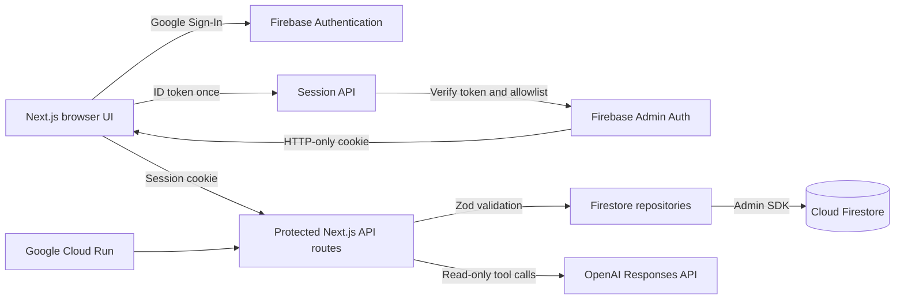

# Company OS

Company OS is a focused internal dashboard for a small startup team. It manages team members, clients, and assigned tasks in Firebase Firestore and includes Company Brain, a read-only OpenAI assistant for questions about live workspace data. The MVP deliberately excludes Gmail, Calendar, Drive API calls, embeddings, and document processing.

## Features

- Google Sign-In through Firebase Authentication with a server-side email allowlist
- Secure, HTTP-only Firebase Admin session cookies
- Dashboard metrics and a read-only Company Brain chat grounded in live Firestore data
- Task create/edit/delete, complete/reopen, assignment, filtering, sorting, and client association
- Team add/edit/archive with historical task preservation
- Lightweight client management with related tasks
- Responsive sidebar, accessible forms, dialogs, loading/empty/error states, and toasts
- Server-only Firestore access, Zod validation, seed data, and Cloud Run container support

## Architecture



All application data goes through protected Next.js route handlers. Firebase Admin credentials are never sent to the browser.

## Local installation

Prerequisites:

- Node.js 22 or newer
- npm
- A Firebase project with billing suitable for Cloud Run deployment
- Firebase CLI (`npm install -g firebase-tools`) and Google Cloud CLI for deployment

```bash
git clone <repository-url>
cd company-brain
npm install
cp .env.example .env.local
```

On PowerShell, use `Copy-Item .env.example .env.local`.

## Firebase and GCP setup

1. Create or select a project in the [Firebase Console](https://console.firebase.google.com/).
2. In **Build → Firestore Database**, choose **Create database**, select production mode, and choose a region near the team. The database creates the `teamMembers`, `tasks`, and `clients` collections when the seed script or app first writes data.
3. Register a Web app in **Project settings → General → Your apps**. Copy its `apiKey`, `authDomain`, `projectId`, and `appId` into the `NEXT_PUBLIC_FIREBASE_*` variables.
4. For keyless local access, run `gcloud auth application-default login` and `gcloud auth application-default set-quota-project <project-id>`. Service-account keys are optional and discouraged.
5. Select the same project in the Google Cloud Console and enable Cloud Run, Cloud Build, Artifact Registry, and Firestore APIs.

Deploy the Firestore rules and indexes:

```bash
firebase login
firebase use <firebase-project-id>
firebase deploy --only firestore:rules,firestore:indexes
```

## Google Sign-In

1. Open **Firebase Console → Build → Authentication → Get started**.
2. Under **Sign-in method**, enable **Google** and choose a project support email.
3. Firebase provisions the Google OAuth client used by the web SDK. The `GOOGLE_CLIENT_ID` and `GOOGLE_CLIENT_SECRET` placeholders are reserved for a future non-Firebase authentication option and are not used by this MVP.
4. Add `localhost` and the deployed Cloud Run hostname under **Authentication → Settings → Authorized domains**.
5. Add the exact approved Google account emails to `ALLOWED_EMAILS`.

The `NEXTAUTH_*` placeholders are retained in `.env.example` for the originally requested environment contract, but this MVP intentionally does not install or use NextAuth/Auth.js.

## Environment variables

Copy `.env.example` to `.env.local` and configure:

- `ALLOWED_EMAILS`: comma-separated, case-insensitive application allowlist
- `COMPANY_TIME_ZONE`: timezone used for today/overdue calculations
- `OPENAI_API_KEY`: server-only key used by Company Brain
- `OPENAI_MODEL`: Responses API model name; defaults to `gpt-5.5`
- `FIREBASE_PROJECT_ID`: required server-side project identifier
- `FIREBASE_CLIENT_EMAIL`, `FIREBASE_PRIVATE_KEY`: optional fallback credentials; leave blank when using local ADC or the Cloud Run service identity
- `NEXT_PUBLIC_FIREBASE_API_KEY`, `NEXT_PUBLIC_FIREBASE_AUTH_DOMAIN`, `NEXT_PUBLIC_FIREBASE_PROJECT_ID`, `NEXT_PUBLIC_FIREBASE_APP_ID`: Firebase web app identifiers

If a private key is used, keep it quoted with escaped `\n` line breaks. Public Firebase web identifiers are expected in the browser; authorization does not rely on hiding them.

If configuration is absent, the sign-in page shows setup guidance and API requests return a clear setup error.

### Company Brain

Company Brain sends the current conversation and only the minimum read-only tool results needed for an answer to OpenAI. OpenAI never receives Firebase credentials or generic database access. Numerical answers come from deterministic server-side Firestore tools; the model selects tools and explains their results.

For local development, add `OPENAI_API_KEY` to `.env.local`. Never use a `NEXT_PUBLIC_` prefix. In Cloud Run, store the key in Secret Manager:

```bash
printf "YOUR_OPENAI_KEY" | gcloud secrets create openai-api-key --data-file=-
gcloud secrets add-iam-policy-binding openai-api-key \
  --member="serviceAccount:company-os-runtime@PROJECT_ID.iam.gserviceaccount.com" \
  --role="roles/secretmanager.secretAccessor"
```

## Seed data

The seed is explicit, idempotent by document ID, and blocked when `NODE_ENV=production`.

```bash
npm run seed
```

It creates Amol and Ezaz, three clients, and eight tasks spanning overdue, today, upcoming, in-progress, and completed work. Edit the seeded team-member emails in the dashboard so one matches a signed-in account for “My Tasks.”

## Run locally

```bash
npm run dev
```

Open [http://localhost:3000](http://localhost:3000). Useful checks:

```bash
npm run lint
npm run typecheck
npm test
npm run build
```

## Deploy to Cloud Run

Create an Artifact Registry repository once:

```bash
gcloud auth login
gcloud config set project PROJECT_ID
gcloud services enable run.googleapis.com cloudbuild.googleapis.com artifactregistry.googleapis.com secretmanager.googleapis.com
gcloud artifacts repositories create company-os --repository-format=docker --location=us-central1
gcloud iam service-accounts create company-os-runtime --display-name="Company OS runtime"
gcloud projects add-iam-policy-binding PROJECT_ID --member="serviceAccount:company-os-runtime@PROJECT_ID.iam.gserviceaccount.com" --role="roles/datastore.user"
gcloud projects add-iam-policy-binding PROJECT_ID --member="serviceAccount:company-os-runtime@PROJECT_ID.iam.gserviceaccount.com" --role="roles/firebaseauth.admin"
```

Build the image. Firebase web values are public build arguments:

```bash
gcloud builds submit --config cloudbuild.yaml --substitutions="_FIREBASE_API_KEY=API_KEY,_FIREBASE_AUTH_DOMAIN=PROJECT_ID.firebaseapp.com,_FIREBASE_APP_ID=APP_ID"
```

Deploy the image shown by Cloud Build using the keyless runtime service account:

```bash
gcloud run deploy company-os \
  --image us-central1-docker.pkg.dev/PROJECT_ID/company-os/company-os:BUILD_ID \
  --region us-central1 \
  --allow-unauthenticated \
  --service-account company-os-runtime@PROJECT_ID.iam.gserviceaccount.com \
  --set-env-vars FIREBASE_PROJECT_ID=PROJECT_ID,ALLOWED_EMAILS=founder1@example.com\\,founder2@example.com,OPENAI_MODEL=gpt-5.5 \
  --set-secrets OPENAI_API_KEY=openai-api-key:latest
```

Cloud Run must be publicly reachable so Google Sign-In can load, but every workspace page and API route still requires an approved authenticated session. Add the resulting hostname to Firebase Authorized domains.

## Security notes

- The browser receives only Firebase web-app identifiers, never Admin credentials.
- Every API handler verifies the signed session and checks `ALLOWED_EMAILS`; Zod validates every mutation.
- Firestore rules require a verified Firebase user with the `appAccess` custom claim. The login endpoint sets this claim for allowlisted users.
- Firebase Admin bypasses Firestore rules by design. Server authorization is therefore the primary boundary and must remain on every new API route.
- Changing `ALLOWED_EMAILS` blocks a removed user on the next server request even if an older custom claim exists.
- Team-member records are assignment metadata and do not grant application access.
- This is an MVP allowlist, not an invitation, organization, or role-based access system.
- Client deletion is blocked while tasks reference the client. Archiving marks the client closed instead.
- Company Brain is read-only, uses bounded tool calls, omits contact details, and cannot mutate Firestore.
- Prompts and minimal query results are sent to OpenAI to generate answers; do not enter unrelated secrets in chat.

## Project structure

```text
app/
  (workspace)/dashboard, tasks, team, clients
  api/auth, company-brain, dashboard, tasks, team, clients
components/
  company-brain, dashboard, tasks, team, clients, ui
lib/
  ai, auth, firebase, firestore, validation
scripts/
types/
tests/
```

## Future roadmap

- Google Drive documents
- Google Calendar
- Gmail
- Additional Company Brain tools and confirmed write actions

See [docs/future-integrations.md](docs/future-integrations.md). Drive, Calendar, and Gmail integrations are documentation-only and are not present in this MVP.
